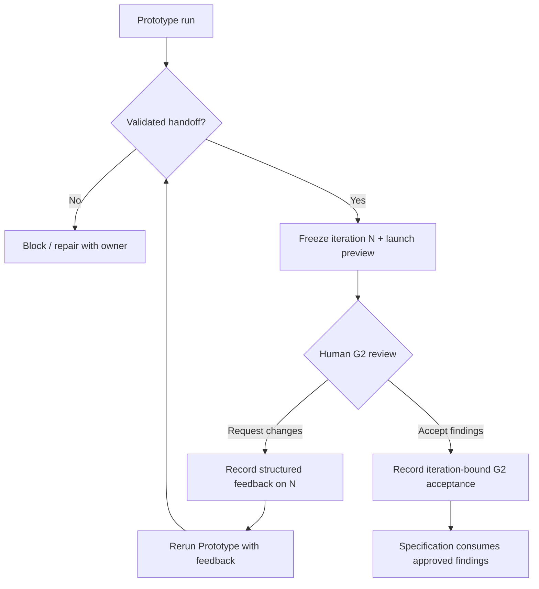

# G2 prototype preview → change request → rerun → renewed approval

This contract is used **after Discovery/G1** and **before Specification/G3**. It is local-first, auditable, versioned, and applies independently of the later MVP EDD phases. The bundled `uv` Python *simulation TUI* implements the loop with a **synthetic static HTML demo**. The separate **MVP 03 live Coordinator** now implements real Codex-generated offline HTML experiments, versioned browser previews and G2 evidence binding. See [MVP 03 review instructions](live-prototype-mvp03.md).

## State transitions



**No G2 decision is transferable.** Every successful rerun creates a new version, new report content, new preview path and new review-bundle identity. On rejected review, the Coordinator remains before Specification; on accepted review, it automatically launches Specification and pauses at G3.

## Reviewer journey in the TUI

1. Run `uv run workflow.py`. Press `N`, then approve Discovery with `A` after inspecting its report.
2. The G2 screen shows **iteration-NNN**, the local preview path, evidence integrity, previous reviewer feedback and the current review-bundle hash. Press **O** to open the actual local HTML file in the system browser. If no browser handler is available, open the displayed absolute path manually.
3. Interact with the demo using sample data. Inspect `prototype-report.md` as well as the preview and notes; static preflight checks cannot demonstrate usability or other human observations.
4. Press **C**. Enter clear feedback (up to 3000 characters) on what should change and how to recognize success. The Coordinator records `feedback.json` and `feedback.md`, marks the reviewed iteration rejected, and automatically dispatches another simulated Prototype run. The **new HTML contains the previous request visibly**, but is **not proof that the requested feature was implemented**.
5. When the new G2 gate appears, press **O** and **review anew**. Accept using **A** only if satisfied; otherwise repeat **C**. `A` checks the pending report hash and the complete current preview/review evidence bundle; stale/tampered files block approval.
6. After **A**, inspect `prototype-acceptance.md`, `product-spec.md`, and the auto-updated `project-ticket.md`. Specification takes **accepted findings only**. A real implementation must separately evaluate any experimental source code for reuse.

For noninteractive review use `uv run workflow.py status <id>` to see the pending gate, and `uv run workflow.py tui <id> --snapshot --width 110 --height 38` to see the versioned preview information without a full-screen terminal.

## Local artifact contract

```text
work/<initiative>/
  prototype-report.md                        # latest simulated report; G2 artifact
  prototype-acceptance.md                    # created only after G2 acceptance
  prototype-review/
    current.json                             # pointer to newest iteration + bundle digest
    iteration-001/
      prototype-report.md                    # immutable snapshot for this review
      preview/index.html                     # browser-openable sample demo
      preview-manifest.json                  # preview type, path, digest, simulation flag
      checks.json                            # actual preflight results; interactive = NOT_EXECUTED
      review-bundle.json                     # content-hash identity for the whole review
      review.json                            # evolving review decision (separate from frozen bundle)
      launch.log                             # honest description of what was launched
      feedback.json, feedback.md             # written on a change request
      approval.json                          # alternatively, written on acceptance
    iteration-002/
      ...                                    # new preview, report and review bundle
```

SQLite records each iteration's ID, state, report hash, preview hash, bundle hash, feedback ID and timestamps. It also keeps the Coordinator's event history and human-gate approval ledger. `project-ticket.md` links the individual iterations and current statuses. GitHub Issues are an **optional mirror**; no remote account is required for the review loop.

## Deterministic checks and boundaries

- Validate the specialist's canonical report and normalized handoff **before** creating a review iteration. An invalid handoff must not generate an approvable preview.
- Treat report, HTML, archived report, manifest, preflight results, review-bundle digest, current pointer and previous human feedback as content-addressed review evidence. Do not accept G2 if any relevant identity differs from the exact pending iteration. Where Git is bound, also verify the selected worktree's branch/commit identity.
- The reviewer must take an **explicit action**. Files, model-generated approval text and a passing preflight do not constitute human approval. In the bundled simulation the local keyboard action is unauthenticated; a production scheduler needs a trusted identity/authorization channel.
- Preserve the previous iteration and feedback; don't mutate their report, demo or bundle. In the simulation, the mutable `review.json` records its final decision while the immutable `review-bundle.json` stays unchanged.
- Resuming a pending gate reads the existing preview and does not create another iteration. A later rerun creates a separate version, never silently reuses the old approval. Failures that leave partial files should be audited and reconciled before a production rerun.
- Preflight `PASS` is about file existence and structural integrity only. `interactive_user_behavior` stays `NOT_EXECUTED` until a real test or recorded human observation supports a claim.
- Preview code is **not production code**. Approved findings become Specification inputs; prototype source reuse requires deliberate review, frozen requirements, fresh RED evidence, GREEN implementation and later independent VERIFY/PROVE.

## Future dynamic-app preview adapter (beyond MVP 03)

MVP 03 handles static self-contained, interactive HTML returned by a real Codex specialist, with no external dependencies or running application backend. A later **dynamic-app preview adapter** would additionally need an isolated worktree, startup command, bounded preview host/port, process ID, health check, smoke-test receipts and cleanup plan. The Coordinator must control launch/stop/recovery and provide a safe reachable URL. Require explicit authorization for external networking, credentials, deployment or writes to production systems. Keep the **same iteration/feedback/G2 hash contract** and use a new Codex specialist session plus the read-only Handoff Agent on every rerun.

The Coordinator records the exact feedback file and its digest in the next review bundle, and invalidates changed accepted evidence. It still cannot *prove* the specialist implemented the human-requested behavior by model assertion: human browser observations and later independent tests remain essential. The isolated MVP 01 `codex-stage` command retains its candidate-only semantics; MVP 03 is the `live-*` integrated review path.
