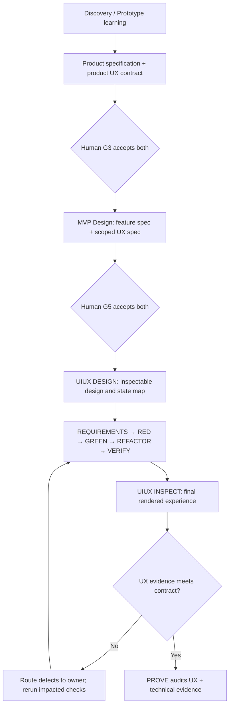

# UI/UX is an explicit quality contract, not an optional polish stage

The workflow now has **eleven specialist roles**: the original four hybrid + six EDD specialists, plus one **UIUX specialist invoked twice per MVP** in separate sessions. The Coordinator and reusable Handoff Agent remain separate; total system roles = **13**. The six canonical EDD stages remain intact.

## End-to-end placement

G4 roadmap review still occurs before G5. For every additional MVP, repeat G5 and the complete UIUX + EDD cycle. A UX check does not authorize a release.

## Mandatory upstream UX deliverables

| Owner | Artifact | Required content and binding |
| --- | --- | --- |
| Discovery | `discovery.md` | Users, top tasks, observed friction, accessibility contexts, research gaps |
| Prototype | `prototype-report.md` + G2 preview | Observed interaction feedback, gaps, responsiveness and usability limitations; prototype approval is not implementation signoff |
| Specification | `product-ux-spec.md` | Product-wide UX IDs, task/journey and screen map, visual/interaction rules, content, keyboard/accessibility, responsive behavior and failure states; **G3 binds this by hash alongside product-spec.md** |
| MVP Design | `mvps/mvp-NN/ux/spec.md` | MVP-specific UX IDs mapped to product UX and MVP ACs; states, viewports, focus, error/recovery, design-system constraints; **G5 binds this by hash alongside the feature spec** |
| UIUX DESIGN | `mvps/mvp-NN/ux/design.md` and `ux/design-review.md` | Detailed flows, layout/wireframes, states, accessible interactions and traceability before implementation |
| UIUX INSPECT | `mvps/mvp-NN/ux/inspection.md` + actual `ux/evidence/` | Read-only inspection of final build, screenshot/interaction evidence, defects and explicit UX_VERIFIED/UX_FAILED/INCONCLUSIVE |

Templates: `templates/product-ux-spec.md`, `templates/mvp-ux-spec.md`, `templates/uiux-inspection.md`. Specialist role: `agents/edd/00-uiux.md`.

## UI/UX coverage that cannot be silently skipped

Every applicable MVP must answer these with IDs and observable oracles:

1. **User goal and task flow:** entry points, navigation, discoverability, completion, undo and recovery.
2. **Layout and visual system:** information hierarchy, spacing, type, color/contrast, components and design-token consistency.
3. **Responsive/adaptive behavior:** approved screen widths, zoom/text scaling, touch, orientation/platform differences.
4. **Accessibility:** meaningful semantics/labels, keyboard/focus order, contrast and assistive technology as relevant.
5. **Complete states:** default, loading, empty, error, offline/timeout, invalid, permission denied, success, disabled and focused states; explain omissions explicitly.
6. **Interaction feedback:** validation, loading feedback, success/error messages, actions, affordances, motion and focus changes.
7. **Language and content:** comprehensible copy, localization, truncation/long-text handling and consistency.
8. **Evidence and regression:** platform-appropriate screenshots/traces or reproducible observations, source revision, and previously approved journeys.

If there is genuinely no user-facing experience in the MVP, record a rationale-based `NOT_APPLICABLE` scope. A blank/missing file is **not** an N/A decision. The human must approve the explicit exclusion at G5; later unexpected UI exposure reopens the upstream contracts.

## Quality and failure routing

- UIUX DESIGN does not edit application code and cannot weaken G5. Unclear or newly required UX scope returns to MVP Design / Specification and the human for a revised scope gate.
- REQUIREMENTS includes UX acceptance IDs in the frozen contract; RED supplies baseline test failures for automatable criteria; GREEN implements; REFACTOR preserves visible behavior.
- VERIFY owns broad independent technical/functional checks. A **new UIUX INSPECT session** follows VERIFY and inspects the actual built experience at the same source/build identity. It is independent of GREEN, although it may use the earlier UIUX design as a specification.
- UIUX INSPECT `UX_FAILED` sends concrete reproduction/screenshots and severity to GREEN, followed by fresh REFACTOR (when needed), VERIFY and UIUX INSPECT. `INCONCLUSIVE` requests missing evidence; both block a genuine PROVE PASS.
- PROVE must reconcile both VERIFY and UIUX results against the same final revision; any behavioral code change invalidates affected screenshots, interactions and verification evidence.
- Do not fabricate screenshots, assert accessibility from markup alone, or claim visual fidelity without actual observation. If a browser/emulator is unavailable, say so.

## What the current terminal prototype demonstrates

`uv run workflow.py` now shows `UX DESIGN` and `UX INSPECT` in the project stage timeline and the per-MVP **V** tracker. The simulation writes example product and MVP UX specs plus mock design/inspection reports, maintains UX 0/2 → 2/2 progress in local parent/MVP tickets, and rejects stale G3/G5 approvals when the companion UX spec changes.

The **default TUI** does not launch live agents or real browser checks. Its
`INSPECTION_RECORDED` means only a simulated handoff, not `UX_VERIFIED`.

The separate **MVP 04 `live-*` path** can run actual project-specific functional
and UX capture commands, save screenshot evidence and launch an independent
read-only Codex UIUX INSPECT agent. The host checks process exits and evidence
hashes, then pauses for human G6 review. It **does not automatically judge image
pixels, keyboard behavior or accessibility**, nor provide a no-screenshot
`NOT_APPLICABLE` adapter. Backend-only MVPs with a formally approved N/A UX
scope need a future dedicated adapter; they must not fabricate an image to
pass this pilot. See [MVP 04](live-evidence-mvp04.md).
